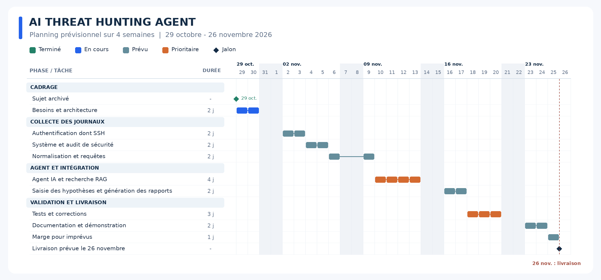

# AI Threat Hunting Agent

## Présentation du projet

Ce projet vise à développer un agent d’intelligence artificielle pour la recherche de menaces dans un environnement local composé d’un Raspberry Pi et d’un PC. L’agent exploite les journaux d’authentification, système et d’audit de sécurité afin de préparer des investigations, rechercher des activités suspectes et produire des conclusions justifiées par des preuves. Le Raspberry Pi héberge les services surveillés ; le PC héberge l’agent IA et le stockage des journaux.

## Planification

Le planning prévisionnel s'étend du **29 octobre au 26 novembre 2026**, du cadrage à la livraison du projet.

Les étapes, les dépendances et les hypothèses sont détaillées dans le [document de planification](docs/project-gantt.md).

## Sujet officiel

**Subject 9: Agent IA de Threat Hunting**

> Construire un agent qui transforme une hypothèse de menace en plan d'investigation, génère des requêtes sur des logs de laboratoire, interprète les résultats et rassemble les preuves. Le système doit justifier ses conclusions, indiquer l'incertitude et associer les observations aux tactiques et techniques MITRE ATT&CK.

Concepts requis : **agent IA, LLM, SIEM/logs, RAG, MITRE ATT&CK**.

L'énoncé est disponible dans [subject.pdf](subject.pdf).

## Qu'est-ce que la recherche de menaces ?

La recherche de menaces, ou *threat hunting*, consiste à rechercher activement des indices d'une attaque, même lorsqu'aucune alerte automatique n'a été déclenchée.

Une investigation commence par une hypothèse, par exemple :

> Quelqu'un a peut-être deviné un mot de passe SSH et accédé au Raspberry Pi.

L'agent transforme cette hypothèse en plan d'investigation : il détermine quels logs pourraient la confirmer ou la contredire, génère les requêtes nécessaires, interprète les résultats et rassemble les preuves. Il explique ensuite ses conclusions, précise les incertitudes et relie les observations aux tactiques et techniques de MITRE ATT&CK. Une hypothèse reste une question à examiner, et non une conclusion à démontrer à tout prix.

Des échecs de connexion répétés peuvent avoir des explications légitimes. Une connexion réussie après plusieurs échecs ne suffit pas, à elle seule, à prouver qu'un compte a été compromis.
