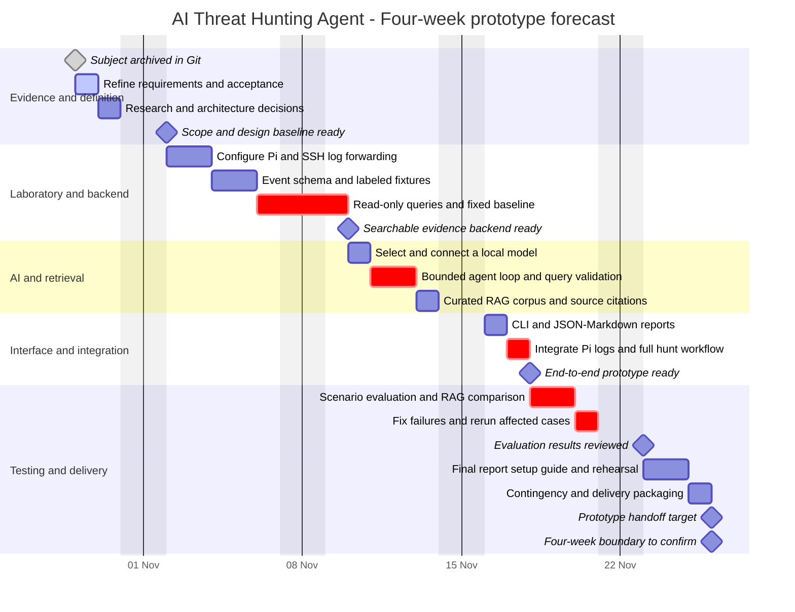

# Project development Gantt chart

**Project:** AI Threat Hunting Agent — subject 9  
**Repository review date:** 29 October 2026 (UTC)  
**Planning horizon:** four calendar weeks, as specified by the project owner  
**Forecast window:** 29 October–26 November 2026  
**Baseline status:** proposed schedule; implementation has not been evidenced

## Evidence and current progress

The review covered all visible project files, the local and remote-tracking Git history, and the working-tree status. No remote fetch was performed.

| Evidence | Finding | Status supported by the evidence |
|---|---|---|
| Commit `96f33eaef08bd84af2d98d41fd24e5a617428e8c` | The only visible commit, “first commit,” added `subject.pdf`. Both author and committer timestamps are **2026-10-29 11:17:42 UTC**. | **Completed:** subject archived in Git on that date. This does not establish when the assignment was written or approved. |
| [subject.pdf](../subject.pdf) | Requires hypothesis-driven investigation, generated log queries, evidence, uncertainty, and MITRE ATT&CK mappings. | Assignment requirements available. No evidence of implementation or acceptance. |
| [README.md](../README.md) | Introductory requirements and workflow; explicitly describes the project as planning. | **Ongoing:** requirements refinement and project documentation. The file is untracked, so its creation date and drafting duration cannot be recovered from Git. |
| [test.md](../test.md) | Detailed planning material covering architecture, hardware roles, RAG, scenarios, evaluation, and open decisions. | A draft design exists; its filename does not represent an executable test suite. It is also untracked. |
| Complete visible file inventory | Three files: `subject.pdf`, `README.md`, and `test.md`. No source code, dependency manifests, deployment configuration, datasets, or executable tests were found. | **Planned:** lab configuration, backend, AI, interface, integration, and evaluation. No technical completion percentage can be established. |

Historical effort cannot be estimated from the single commit. The completed activity is therefore a zero-duration milestone. The active requirements bar represents **estimated remaining effort**, rather than a measured historical work period.

## Four-week development schedule

Only the subject archival milestone is a confirmed historical date. All other task dates are **forecasts**, derived from the owner's four-week constraint and the assumptions below. Approval, readiness, and delivery milestones are targets, not accomplished events.

**Legend:** `done` means historically evidenced; `active` means the current planning activity; untagged bars are planned; `crit` highlights delivery-critical engineering and evaluation; diamonds are milestones. Dependencies use `after`. The implementation chain is deliberately sequential for one developer: tasks outside the highlighted subset can also delay delivery.

## Phases, effort, and dependencies

Effort estimates total **20 working days**, including **one contingency day**. Weekends are excluded. This corresponds to approximately 120–140 focused hours if 6–7 hours per working day are available; actual availability is unconfirmed. Phase dates below show work periods, while dependent milestones occur at the following task boundary.

| Phase | Forecast work period | Effort | Output and dependency |
|---|---|---:|---|
| Requirements, research, architecture | 29–30 Oct | 2 days | Freeze SSH-focused scope, acceptance criteria, PC inventory, model shortlist, event schema outline, and architecture. These choices gate implementation. |
| Lab and evidence backend | 2–9 Nov | 6 days | Configure Pi telemetry, normalize events, prepare labeled scenarios, implement bounded read-only queries, and establish the fixed-query baseline. The agent depends on this verified interface. |
| AI and RAG | 10–13 Nov | 4 days | Connect the model, implement a bounded tool-use loop, and retrieve a small reference corpus with citations. Backend and model access must work first. |
| Interface and integration | 16–17 Nov | 2 days | Provide CLI inputs and JSON/Markdown outputs, then complete a Pi-log-to-report investigation. Depends on the backend, agent, and retrieval pipeline. |
| Evaluation and correction | 18–20 Nov | 3 days | Compare with the baseline, compare with/without RAG, test benign and suspicious cases, check uncertainty and evidence references, then fix and retest failures. |
| Documentation, rehearsal, reserve | 23–25 Nov | 3 days | Finalize the report and setup instructions, rehearse a reproducible demonstration, and retain one day for overruns or packaging. |
| Handoff | 26 Nov | Milestone | Derived four-week boundary; exact submission time, defense date, and review arrangements await confirmation. |

Design notes, query contracts, and experimental records should be updated within each phase. The final documentation allowance covers consolidation and rehearsal rather than writing the entire report from scratch.

## Scope required to fit four weeks

This is a feasible **prototype estimate**, contingent on daily availability and working hardware. It does not promise a production system.

- One Raspberry Pi 5 with 8 GB RAM as the monitored host; the PC hosts the AI and evidence backend.
- SSH authentication events and three scenarios: benign activity, repeated failures, and failures followed by success. Include missing-log and invalid-query cases during evaluation.
- One event backend. Use SQLite and a lightweight collector as the scheduling assumption; a full SIEM deployment requires re-estimation if selected.
- One existing instruction model. Use the first model that meets a small query-generation/tool-use check on the PC; custom model training is outside this baseline.
- One bounded agent, with validated read-only tools, time windows, query limits, and explicit tool-error feedback.
- A small, curated reference corpus and lexical retrieval. Embeddings and hybrid retrieval are extensions if time remains.
- A CLI as the user interface. There is no existing frontend; a browser dashboard is outside the baseline.
- Reports must distinguish observed events from interpretations, cite evidence and reference documents separately, state uncertainty, and justify ATT&CK mappings.
- No automated remediation, multi-agent architecture, multi-host deployment, or additional detection domains within this four-week estimate.

If the PC cannot run an adequate local model, revisit the model choice and hardware assumptions immediately. Do not silently substitute external inference or expand infrastructure work beyond the reserve.

## Acceptance gates

| Gate | Forecast boundary | Evidence required before marking complete |
|---|---|---|
| Design baseline | 2 Nov | Agreed scope, hardware check, backend and model decisions, tool contract, and evaluation criteria. |
| Evidence backend | 10 Nov | Reproducible event ingestion, labeled fixtures, correct bounded queries, and baseline results. |
| End-to-end prototype | 18 Nov | A hypothesis produces an executed investigation and a report grounded in actual returned events and retrieved references. |
| Evaluation review | 23 Nov | Recorded query/evidence correctness, false positives and missed findings, mapping review, runtime, uncertainty behavior, and RAG comparison. |
| Handoff | 26 Nov | Reproducible setup, source and data instructions, sample reports, limitations, results, and a rehearsed demonstration. |

A suspicious pattern should not automatically be labeled as a confirmed compromise. The evaluation must include independently reviewed expected conclusions and benign cases.

## Dates and decisions requiring confirmation

1. **Start date:** the plan uses the review date, 29 October 2026. Confirm whether development starts immediately.
2. **Deadline:** four calendar weeks from that date gives 26 November 2026. Confirm the exact submission date, time, timezone, and any different defense date.
3. **Availability:** confirm one developer and approximately five full working days per week. Lectures, holidays, exams, and supervisor availability have not been scheduled.
4. **Approval and reviews:** confirm who reviews the scope, scenario labels, evaluation results, and final deliverables. No supervisor approval is evidenced.
5. **Hardware readiness:** PC RAM, GPU, operating system, and existing Pi configuration remain unverified.
6. **Technical choices:** confirm the one-backend, local-model, small-corpus, CLI-first scope before treating these effort estimates as a committed baseline.
7. **Existing work elsewhere:** no evidence of implementation outside the inspected checkout was supplied. If it exists, reassess completed tasks using its artifacts and history.
8. **Report expectations:** confirm the required academic format, language, assessment criteria, and whether a web interface or full SIEM is mandatory.

## Updating and rendering the chart

Replace forecasts with actual dates only when supported by commits, working artifacts, evaluation records, or explicit review decisions. Do not infer task completion solely from the presence of a planning document.

The diagram uses standard Mermaid Gantt status tags, dependencies, exclusions, and milestones; see the [official Mermaid Gantt documentation](https://mermaid.js.org/syntax/gantt.html). Forecasts were checked against a five-day working calendar and task dependencies. No Mermaid renderer is installed in this checkout, so visual rendering has not been verified locally. For an academic report, render to SVG in a Mermaid-capable editor and review label placement before inclusion.

Only planning documentation is added by this change. Existing project files are preserved.
